# Прототип интерфейса

[`prototype/pmo-prototype.html`](../prototype/pmo-prototype.html) — интерактивный прототип портала в одном HTML-файле, без зависимостей. Это эталон UX и техническое задание для приложения SPFx ([SPEC.md](SPEC.md)): экраны, тексты на трёх языках (словари `T` и `FLD`, значения выбора — `VAL`), цвета и размеры (CSS-переменные), правила расчёта.

## Как открыть

Двойной щелчок по файлу — откроется в браузере. Или локальный сервер:

```bash
cd prototype && python3 -m http.server 8765
```

Затем `http://127.0.0.1:8765/pmo-prototype.html`. Данные прототипа — демонстрационные, живут в памяти страницы или в базе артефакта claude.ai (`window.claude`); кнопка «Скинути до демо-даних» внизу страницы сбрасывает их к исходным.

## Что можно проверить

- новый проект, редактирование карточки;
- статус-отчёт с изменением показателей и обязательной причиной;
- погодження PMO: «Погодити», «Погодити зі зміною оцінок», «Повернути на доопрацювання»; «Новий звіт на основі повернутого»;
- «Завершено» или «Скасовано» → проект в архиве;
- «Змінити PM / власника» (PMO);
- риск с живым расчётом оценки и правилом срока «Термін виконання заходів» (#88);
- комментарий;
- сповіщення: колокольчик, «Лише нові», «Позначити все прочитаним»;
- «Доступ до картки»;
- ширина и порядок колонок, фильтры, закреплённые заголовки; телефон (узкое окно);
- «увійти як інший користувач» (меню аватара) — как видят портал PM, PMO (Олександра Мороз), руководители по цепочке (CEO, CIO, директора), собственник, стейкхолдер, посторонний (только в прототипе);
- светлая и тёмная темы, UA / EN / RU.

- «?» в шапке — «Довідка» (та же инструкция, что в приложении), версия и «Що змінилося» (технические выпуски — одним свёрнутым блоком), «Детальний огляд системи» (картинки и PDF — из `docs/overview/`);
- «Відгуки»: вкладка с таблицей и представлениями, «Залишити відгук» (текст, до 5 скриншотов, вставка из буфера), отзыв с «‹ №N ›»; статус и ответ ставит владелец сайта (в демо — Юрій), автору — сповіщення «Відгук розглянуто»; «Новий випуск порталу» в колокольчике;
- «Оновити дані» и «CSV» над таблицами.

Тексты «Довідки», «Що змінилося» и «Огляду» в прототипе — сгенерированные блоки (`/* <generated:help> */`, `/* <generated:overview> */`): их пишут те же `npm run guide` и `npm run overview`, что и для приложения; Jest сверяет (`spfx/test/prototypeHelp.test.ts`). Руками не править.

**Сверка с тестовым порталом 18.10.2026** — прототип повторяет портал (портал не менялся): полный реестр — `docs/superpowers/plans/2026-10-18-prototype-parity.md`. Как проверено: снимок вычисленных стилей каждого элемента портала и прототипа в одинаковом окне (1910×1267) по всем экранам и формам — остались только отличия данных (демо и тестовый сайт). Как устроено, чтобы прототип не менял портал: тексты, которых портал не берёт из прототипа, — в `T_PROTO`; стили телефона, касаний и таблиц — в прототипе (единый источник для портала), в `overrides.scss` портала — только нужное SharePoint; генерация текстов и стилей портала из прототипа даёт ровно файлы портала (тест `spfx/test/prototypeExtract.test.ts`).

Роли демо как в портале: Юрій — владелец сайта (видит всё, правит любой проект, создаёт проекты, погоджує и меняет PM / власника, отвечает на отзывы), Олександра Мороз — PMO.

**Ошибки портала, которые прототип не повторяет** (прототип в этих местах верен; портал — отдельной задачей): «Загальний стан» в форме отчёта в EN / RU — по-украински; ссылка с названием, но без адреса, молча пропадает; строка команды с ролью без человека — ошибка «роль» вместо пропуска; причина изменения показателей сохраняется, даже если показатели вернули; тексты сохраняются с пробелами по краям; власника риска можно оставить пустым; срок заходів старой записи без даты создания — «не раньше сегодня»; имя CSV «archive2-…», «feedback2-…».

Нет в прототипе (только в приложении): состояния синхронизации SharePoint (проект готовится, отчёт обновляется, проверки свежих данных перед записью), правка по прямой ссылке без прав, вход Microsoft помощника ИИ и его сбои, «Набір перевірок ШІ».

## Экраны

> Скриншоты в `docs/img/` сняты с прототипа 12.10.2026, помощник ИИ — 14.10.2026, «Довідка» и «Відгуки» — 17.10.2026 (UA, светлая тема; «Головна» и проверка ИИ — тёмная), окно 1440 × 900 (сохранены в 1389 × 868), «Головна» — во всю высоту.

**Головна** — сводка портфеля, динамика, проблемные проекты, проекты без свежего отчёта, запросы на решение, открытые риски.

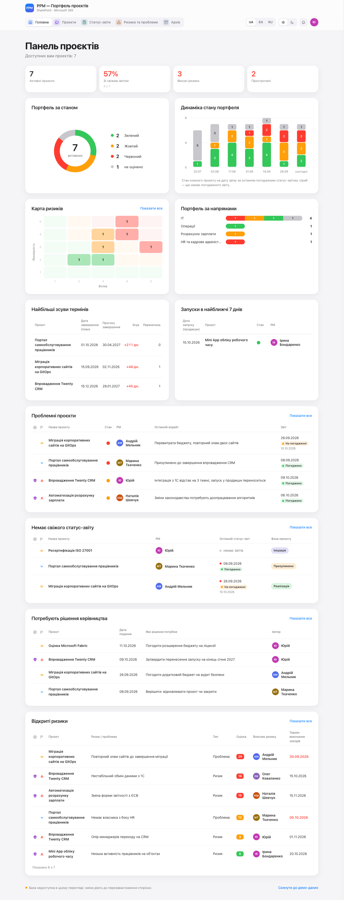

**Проєкти — плитки**

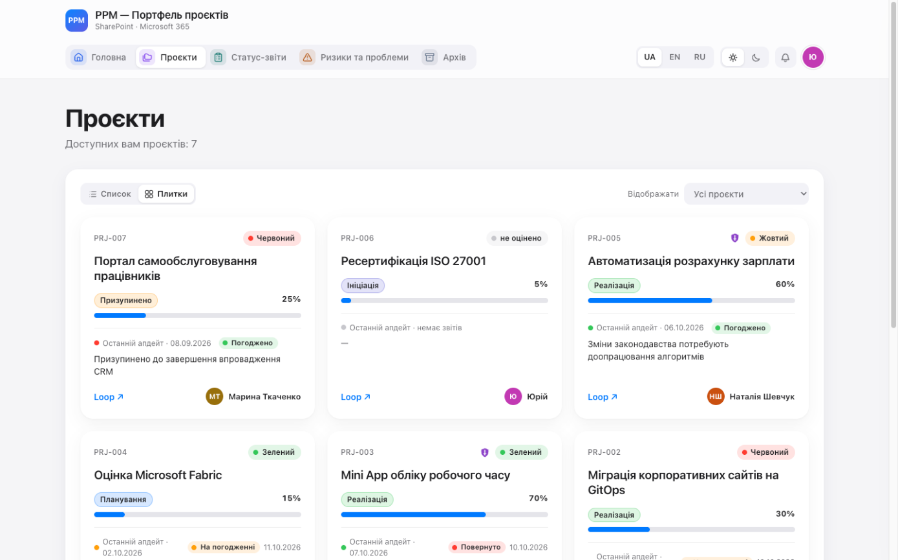

**Проєкти — список** с выбором колонок, сортировкой и фильтрами

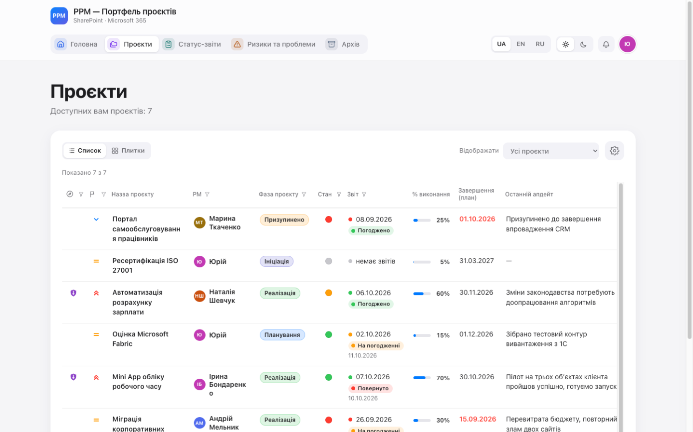

**Карточка проекта** в выдвижной панели

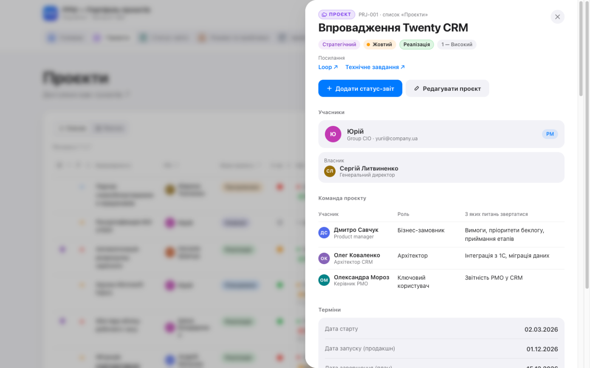

**Новий статус-звіт** — подстановка текущих показателей и живой расчёт общего состояния

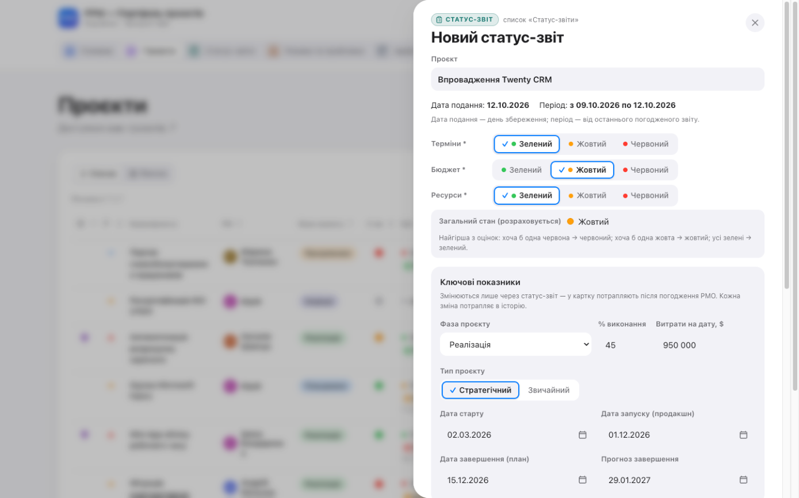

**Помічник ШІ (пілот)** — меню пользователя, вверху — переключатель «Помічник ШІ» (выключен по умолчанию — форма без ИИ, как вне пилотной группы приложения; включён — форма с ИИ) и переключатель «Імітувати збій ШІ (демо)» (доступен при включённом помощнике): ИИ не отвечает, отчёт сохраняется «Зберегти без перевірки», в нём причина «Перевірку ШІ не виконано: …» (её видит PMO). Ответы ИИ в прототипе — демо из данных проекта (агента нет); правила формы — те же функции, что в приложении (общие векторы `tests/cases/ai-check.json`, `ai-flow.json`, `ai-rules.json`, тест `spfx/test/prototypeAi.test.ts`). «Заповнити з ШІ» — черновик, «Що не забути» и предлагаемые оценки:

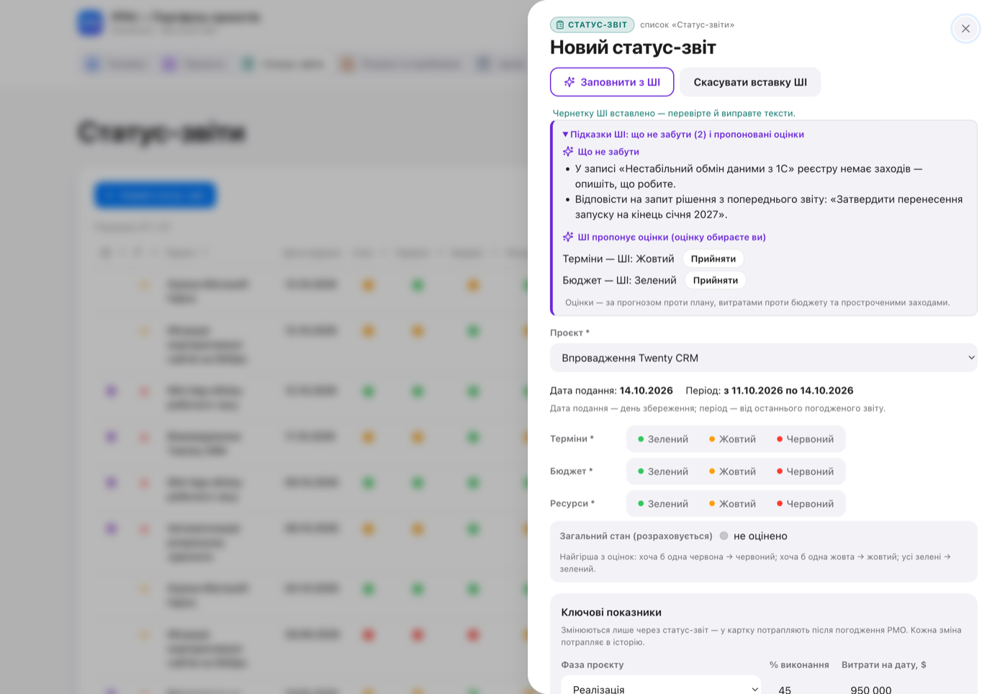

«Перевірити з ШІ» — пункты портала (сравнения дат и сумм) и ИИ в поле «Суперечності (аналіз ШІ)», затем «Зберегти» (тёмная тема):

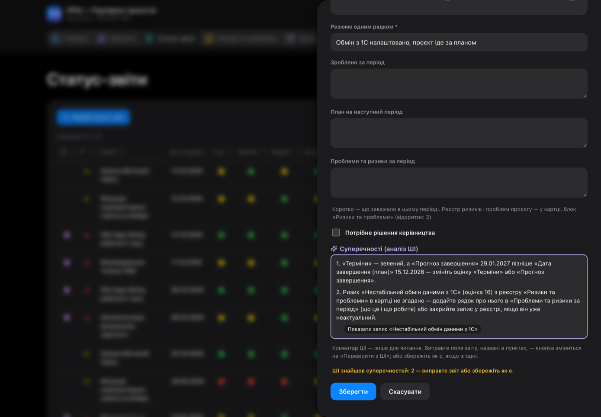

**Статус-звіти**

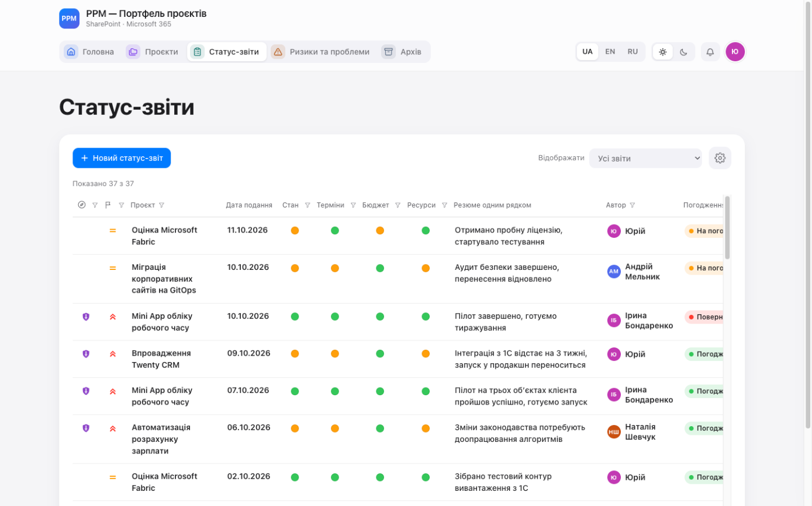

**Ризики та проблеми** и форма риска

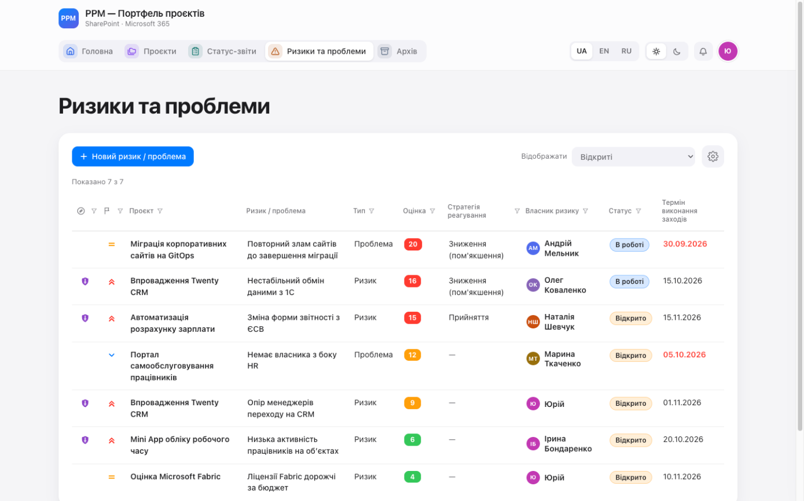

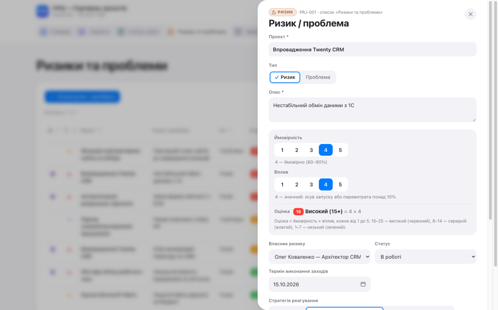

**Архів**

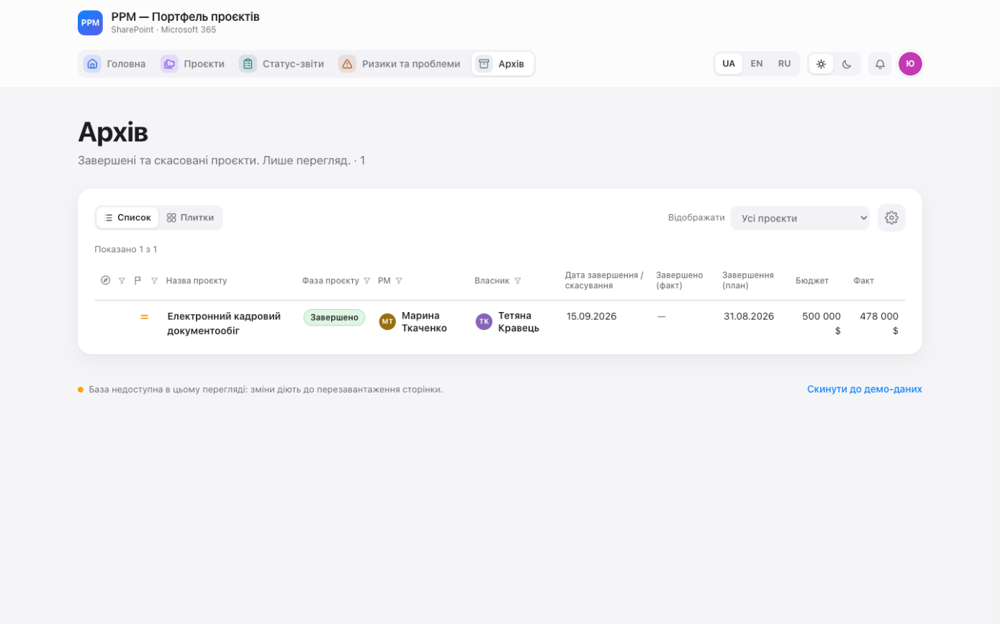

**Довідка** и **Що змінилося**

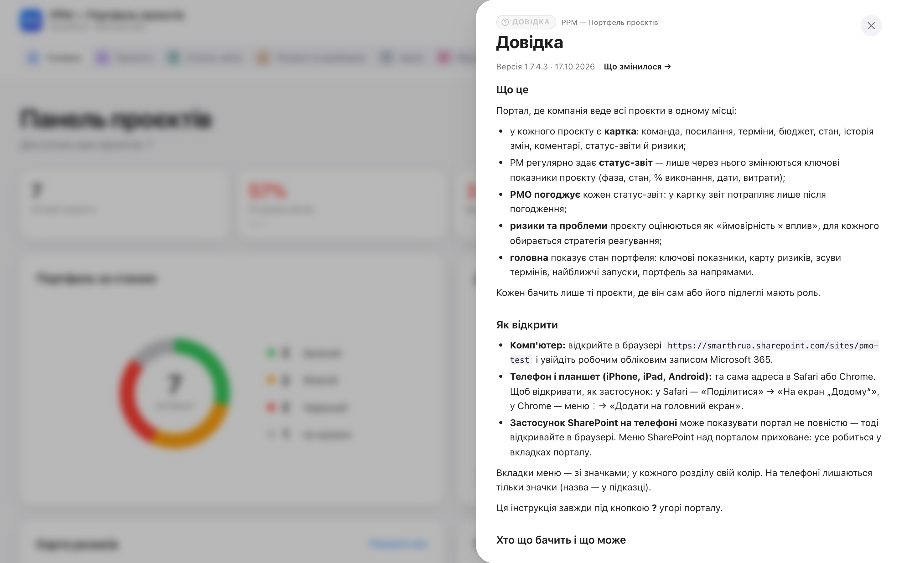

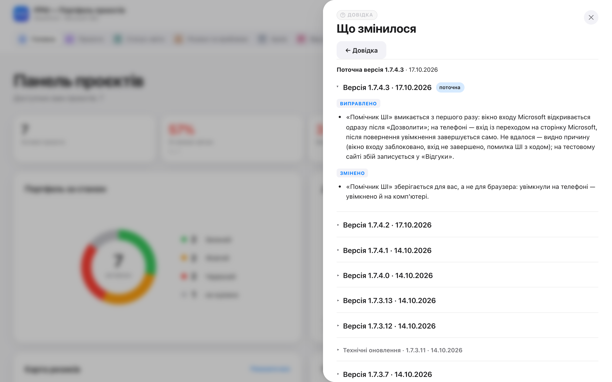

**Відгуки** — список и отзыв (владелец сайта ставит статус и ответ)

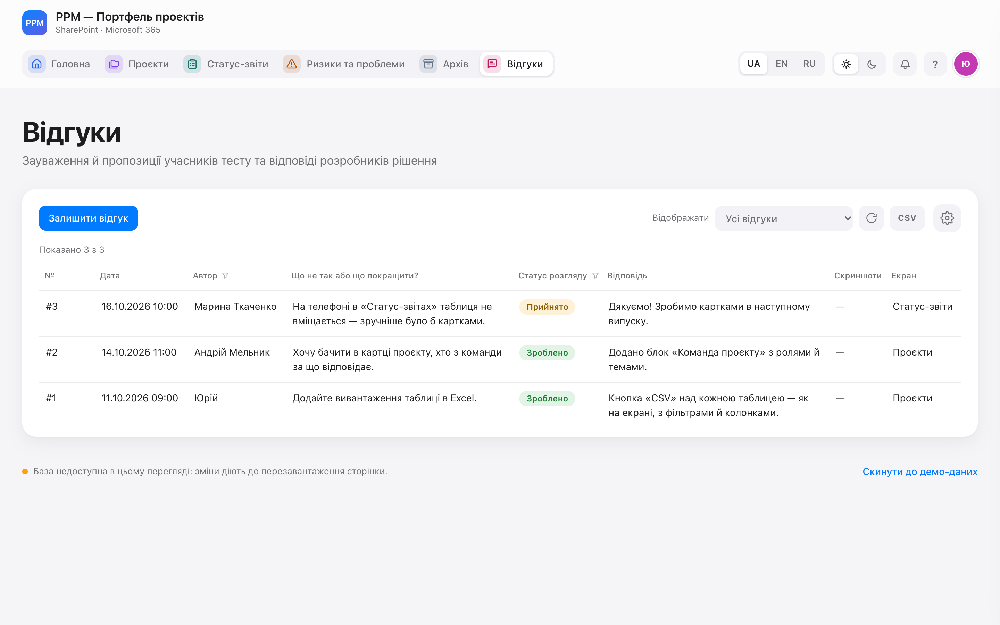

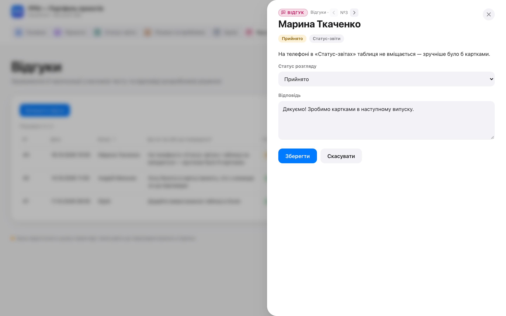

**Тёмная тема**

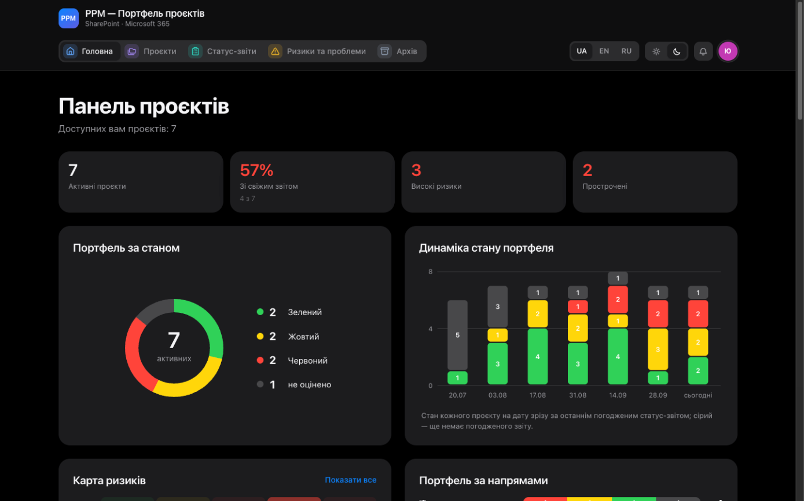

## Что из прототипа не переносится в приложение

Только для демонстрации: «увійти як інший користувач», справочник сотрудников `ORG`, демо-данные и кнопки их загрузки, индикатор источника данных, хранение данных в странице или базе артефакта (`window.claude`). В приложении люди — из каталога Microsoft 365, данные — в списках SharePoint, права — фактические.

## Как меняется прототип

Прототип меняется вместе с приложением: одно требование не должно жить только в одном месте. Стили приложения генерируются из прототипа: `spfx/tools/extract-prototype.mjs` → `spfx/src/webparts/pmoPortal/theme/prototype.scss`. Скриншоты в `docs/img/` сняты с прототипа (светлая тема, UA) в Chrome.
